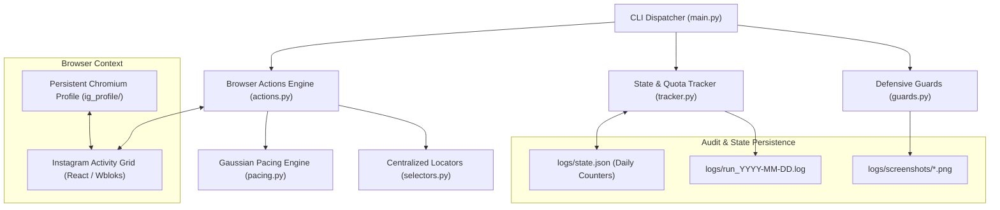

# rebrand

> Defensive, human-paced Instagram interaction automation engine built with Playwright and Python.

[](https://www.python.org/)
[](https://playwright.dev/)
[](LICENSE)
[](#system-architecture)
[](#security-and-privacy-model)

A resilient, human-paced automation system built with Python and Playwright to programmatically review and bulk-unlike historical posts through Instagram's official "Your Activity" web interface.

Designed with defensive engineering principles, statistical interaction jitter, persistent browser session isolation, and proactive rate-limit guards to protect account standing while automating repetitive administrative tasks.

---

## Table of Contents

- [System Architecture](#system-architecture)
- [Key Engineering Features](#key-engineering-features)
- [Security and Privacy Model](#security-and-privacy-model)
- [Repository Layout](#repository-layout)
- [Prerequisites](#prerequisites)
- [Installation](#installation)
- [Quickstart Guide](#quickstart-guide)
- [CLI Command Reference](#cli-command-reference)
- [Configuration Reference](#configuration-reference)
- [Defensive Engineering and Guards](#defensive-engineering-and-guards)
- [Contributing](#contributing)
- [License](#license)
- [Disclaimer](#disclaimer)

---

## System Architecture

The tool is organized into decoupled layers ensuring high maintainability, resilient DOM handling, and deterministic state tracking:



---

## Key Engineering Features

### 1. Statistical Gaussian Pacing
Unlike standard bots that execute clicks at fixed, easily detectable intervals, this engine uses a truncated Gaussian (normal) distribution to introduce randomized micro-delays between interactions:
- **Click Jitter:** 0.5s to 1.4s between selecting individual post elements.
- **Batch Cooldown:** 12.0s to 25.0s between deletion batches.
- **Scheduled Rest Intervals:** Periodic 1 to 3-minute pauses every 4 to 6 batches to mimic natural human focus interruptions.

### 2. Zero-Credential Architecture
Your Instagram credentials and two-factor authentication (2FA) tokens are never handled, parsed, or stored in code or configuration files. Authentication is performed once via a standard Chromium window, persisting session cookies and tokens locally inside an isolated directory that is strictly excluded from version control.

### 3. Asynchronous Settlement Verification
Meta's web application relies on asynchronous GraphQL mutations and virtualized list rendering. The action engine monitors network idle states, watches for spinner element detachment, verifies dialog visibility transitions, and confirms UI counter state resets before advancing to subsequent batches.

### 4. Proactive Block Detection and Forensic Auditing
If Instagram presents an account warning, checkpoint redirect, or rate-limit prompt (such as "Action Blocked" or "Try Again Later"), the guard subsystem immediately aborts all execution threads and captures a full-page timestamped forensic screenshot in `logs/screenshots/` for review.

### 5. Daily Quota Enforcement and Persistence
To prevent triggering automated platform limits, execution is bounded by an atomic daily budget (default: 250 unlikes per 24-hour cycle). Progress is tracked in a local JSON state ledger that resets automatically across calendar dates.

---

## Security and Privacy Model

Security and data isolation are core design requirements:

| Security Vector | Implementation Detail |
| :--- | :--- |
| **Authentication** | Handled natively by Chromium. No passwords, session keys, or OTPs are ingested by application scripts. |
| **Session Isolation** | Browser state resides in `ig_profile/`, keeping user data partitioned from system directories. |
| **Git Exclusion** | Version control rules strictly ignore `ig_profile/`, `logs/`, environment variables, and cached assets. |
| **Local Execution** | Zero telemetry, zero analytics, zero external API dependencies. All computation runs purely on your machine. |

---

## Repository Layout

```text
rebrand/
|-- .gitignore           # Excludes session data, local logs, and virtual environments
|-- LICENSE              # Open source license (MIT)
|-- README.md            # System documentation and operational guide
|-- requirements.txt     # Locked production dependencies
|-- config.py            # Centralized runtime limits, delays, and threshold definitions
|-- selectors.py         # Resilient DOM selectors targeting Meta web components
|-- guards.py            # Defensive detection for blocks, popups, and challenges
|-- pacing.py            # Statistical delay distributions and natural scroll emulators
|-- tracker.py           # Quota verification, state persistence, and audit logging
|-- actions.py           # DOM interaction workflows, batch selection, and settlement checks
`-- main.py              # CLI entrypoint and execution coordinator
```

---

## Prerequisites

- **Operating System:** Windows 10/11, macOS 12+, or Ubuntu 20.04+
- **Python:** Version 3.9 or higher
- **Network:** Stable internet connection

---

## Installation

### 1. Clone the Repository

```bash
git clone https://github.com/hMiZ-STD/rebrand.git
cd rebrand
```

### 2. Create and Activate Virtual Environment

**On Windows (PowerShell):**
```powershell
python -m venv venv
.\venv\Scripts\Activate.ps1
```

**On macOS / Linux:**
```bash
python3 -m venv venv
source venv/bin/activate
```

### 3. Install Dependencies

```bash
pip install -r requirements.txt
playwright install chromium
```

---

## Quickstart Guide

### Step 1: Initialize Session via Manual Login

Run the login wizard to establish your authenticated profile:

```powershell
python main.py --login
```

1. A Chromium browser window will open displaying the official Instagram login page.
2. Enter your credentials, complete 2FA approval, and navigate to your home feed.
3. Return to the terminal and press `Enter` to persist your session to `./ig_profile/`.

### Step 2: Verify Daily Quota and State

Check your current budget usage and baseline numbers:

```powershell
python main.py --status
```

### Step 3: Run Non-Destructive Dry-Run

Verify selector compatibility and DOM traversal without performing any unlikes:

```powershell
python main.py --dry-run
```

The browser will navigate to your likes grid, enter select mode, select a small batch, and cancel the selection safely.

### Step 4: Execute a Micro-Test

Perform a live run with a small batch limit to verify end-to-end network mutations:

```powershell
python main.py --test 5
```

### Step 5: Start Full Autonomous Run

Run the automated loop adhering to daily limits, randomized pacing, and safety breaks:

```powershell
python main.py --run
```

---

## CLI Command Reference

| Flag | Argument | Description |
| :--- | :--- | :--- |
| `--login` | None | Launches browser for initial interactive login and session initialization. |
| `--status` | None | Displays current daily budget utilization, total historical unlikes, and remaining estimates. |
| `--dry-run` | None | Executes navigation and item selection without committing unlike mutations. |
| `--test` | `[N]` (optional, default: 5) | Performs a single live test batch of `N` items. |
| `--run` | None | Runs the full batch processing loop until daily budget or end of list is reached. |
| `--codegen` | None | Launches the Playwright Inspector with the active session profile for locator debugging. |

---

## Configuration Reference

Key execution parameters can be adjusted in [config.py](config.py):

| Parameter | Type | Default | Description |
| :--- | :--- | :--- | :--- |
| `DAILY_BUDGET` | `int` | `250` | Maximum number of unlikes allowed in a single 24-hour window. |
| `MAX_BATCH_SIZE` | `int` | `50` | Maximum post items selected per individual deletion modal pass. |
| `CLICK_DELAY_MIN` | `float` | `0.5` | Minimum delay in seconds between post selections. |
| `CLICK_DELAY_MAX` | `float` | `1.4` | Maximum delay in seconds between post selections. |
| `BATCH_DELAY_MIN` | `float` | `12.0` | Minimum cooldown in seconds between successive batches. |
| `BATCH_DELAY_MAX` | `float` | `25.0` | Maximum cooldown in seconds between successive batches. |
| `COFFEE_BREAK_DURATION_MIN` | `float` | `60.0` | Minimum duration in seconds of a periodic rest interval. |
| `COFFEE_BREAK_DURATION_MAX` | `float` | `180.0` | Maximum duration in seconds of a periodic rest interval. |
| `HEADLESS` | `bool` | `False` | Run browser in headed mode for transparency and safety. |

---

## Defensive Engineering and Guards

The automation includes explicit protection layers to handle platform quirks and edge conditions:

- **Modal Trap Prevention:** Uses strict compound locators for the confirmation modal (`div[role="dialog"]:has-text("Unlike")`) to prevent clicking background elements or dismissing unintended prompts.
- **Virtualized DOM Scroll Handler:** When post thumbnails fall outside the active viewport, the engine performs stepped, variable-distance mouse wheel events to trigger lazy-loading of older items.
- **Stuck Counter Protection:** If the interface fails to enter selection mode or encounters empty passes across consecutive iterations, execution automatically terminates to avoid infinite loops.
- **Forensic Snapshots:** Every unhandled exception or platform block triggers a high-resolution, full-page PNG capture saved to `logs/screenshots/`.

---

## Contributing

Contributions, bug reports, and enhancements are welcome.

1. Fork the repository.
2. Create a feature branch: `git checkout -b feature/improved-locator`.
3. Verify your changes pass standard Python linting (`flake8` / `black`).
4. Commit your changes: `git commit -m "Enhance modal confirmation locator"`.
5. Push to the branch: `git push origin feature/improved-locator`.
6. Submit a Pull Request.

---

## License

Distributed under the MIT License. See [LICENSE](LICENSE) for more details.

---

## Disclaimer

This software is an independent open-source automation utility designed for personal account data management. It is not affiliated with, authorized, maintained, sponsored, or endorsed by Instagram, Meta Platforms, Inc., or any of their affiliates. Use responsibly and in compliance with all relevant terms of service.
